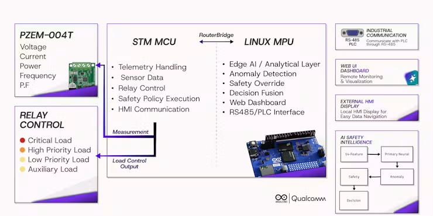
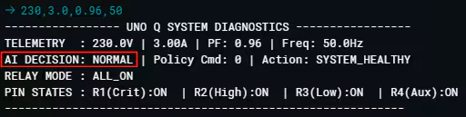
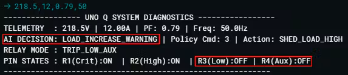
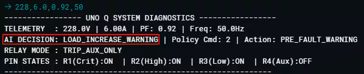

# NeuralGrid

**A Dual-Processor Edge AI Framework for Predictive Electrical Load Management and Priority-Aware Control**

[](https://www.arduino.cc/)
[](#ai-engine)
[](#safety-notice)
[](#publication)

> **Measure → Analyze → Predict → Decide → Act**  
> Edge intelligence · Temporal electrical analysis · Safety-constrained load shedding

NeuralGrid is a working dual-processor edge-AI prototype that continuously analyses electrical behaviour, predicts risk **before** a hard limit is reached, fuses AI decisions with deterministic safety rules, and manages loads according to priority — without granting a learned model unrestricted control authority.

---

## Safety Notice

> **This is a research / laboratory prototype.**  
> It has been exercised at low current levels under controlled conditions.  
> It is **not** certified protection equipment and is **not** production-ready.  
> Hard safety limits and an independent emergency-stop path are implemented, but all behaviour must be treated as experimental.  
> Do not connect to critical or high-energy loads without independent professional protection design.

---

## Why NeuralGrid?

| Conventional protection | NeuralGrid |
|-------------------------|------------|
| Measure → Threshold → Trip | Measure → Behaviour analysis → Prediction → Risk assessment → Decision fusion → Priority shedding |
| Reacts after a limit is crossed | Interprets *how* the system is evolving toward a limit |
| Often binary / feeder-wide trip | Selective, priority-aware load reduction |
| Threshold only | Threshold **plus** temporal features + dual AI + safety fusion |
| AI (if any) often cloud-side or advisory-only | On-device assessment with **deterministic final authority** on the MCU |

**Research position:** The contribution is **architectural and integrative**, not a claim of a newly invented neural-network algorithm. The work establishes a testable foundation for comparing safety-constrained, temporal edge assessment against pure threshold logic.

---

## System Architecture



| Layer | Processor | Responsibility |
|-------|-----------|----------------|
| **Real-time control** | STM32 (UNO Q MCU) | Telemetry, local features, relay policy, HMI, RS-485, E-STOP |
| **AI / analytics** | Linux (Qualcomm MPU) | 14-feature NN, Edge Impulse anomaly, safety evaluation, decision fusion, web dashboard |

Communication between the two sides uses the UNO Q **RouterBridge**.  
**Design rule:** The AI returns a decision; the STM32 applies the policy and drives the hardware.

### Control loop

```
PZEM-004T telemetry
        ↓
STM32 (validate + local features)
        ↓  Bridge.call("predict_json")
Linux AI engine
  • 14-feature neural network (4-class)
  • Edge Impulse anomaly detector
  • Deterministic safety overrides
  • Decision fusion
        ↓  JSON decision
STM32
  • Priority relay policy
  • Local HMI (I²C)
  • RS-485 status (TX)
  • Emergency-stop override
```

---

## AI Engine

### 14-feature vector

| # | Feature | Role |
|---|---------|------|
| 1–6 | Voltage, Current, Power, Energy, Frequency, Power Factor | Instantaneous electrical state |
| 7 | Load Priority | Operating context |
| 8–9 | Voltage deviation, PF deviation | Distance from nominal |
| 10 | Utilization | Current relative to reference |
| 11–13 | dI/dt, dV/dt, Current variance | **Temporal** change & instability |
| 14 | Thermal Index | Accumulated stress (I²t-style indicator, not physical temperature) |

Temporal features allow the system to see **trends**, not only a snapshot.

### Dual models + safety

1. **Primary model — Multilayer Perceptron (14-32-16-4)**  
   - Input: 14 standardised features  
   - Hidden: 32 → 16 (ReLU)  
   - Output: 4-class softmax  
   - Classes: `NORMAL` · `LOAD_INCREASE_WARNING` · `OVERLOAD_RISK` · `CRITICAL_CONDITION`  
   - Artefacts: `weights.pkl`, `scaler.pkl`

2. **Secondary model — Edge Impulse anomaly detector**  
   - Independent time-series / feature-space anomaly evidence  
   - Artefact: `model.eim`

3. **Deterministic safety engine**  
   - Hard electrical limits that can override AI recommendations  

4. **Decision fusion**  
   - Combines classifier, anomaly flag, and hard limits into a policy command for the STM32  

**Priority shedding order (prototype):** Auxiliary → Low → High (Critical protected longest).

---

## Repository Layout

```
NeuralGrid/
├── README.md
├── LICENSE
├── CITATION.cff
├── app.yaml
├── .gitignore
├── firmware/sketch/          # STM32 real-time control
├── ai/python/                # Linux AI engine + models
├── dashboard/assets/         # Web UI
├── docs/                     # Architecture, safety, paper summary
│   └── images/
├── hardware/                 # Pinout notes
└── scripts/                  # Synthetic data helper
```

Legacy paths `sketch/`, `python/`, and `assets/` are kept for Arduino App Lab compatibility.

---

## Quick Start (high level)

1. **Hardware:** Arduino UNO Q, PZEM-004T, 4-channel relay module; optional TFT HMI, MAX485, E-STOP.
2. **Firmware:** Flash `firmware/sketch/sketch.ino` (or `sketch/sketch.ino`) to the STM32 side.
3. **AI engine:** On the Linux side, install `ai/python/requirements.txt`, keep model files in place, run `main.py`.
4. **Dashboard:** Assets under `dashboard/assets/` (or `assets/`).

Details: [docs/getting-started.md](docs/getting-started.md).

---

## Live behaviour (example)

| Condition | AI class (example) | Typical relay action |
|-----------|--------------------|----------------------|
| Healthy | `NORMAL` | All loads ON |
| Rising load | `LOAD_INCREASE_WARNING` | Shed Auxiliary first |
| Higher risk | `OVERLOAD_RISK` region | Shed Low + Auxiliary |
| Hard limit / E-STOP | Safety override | All relays OFF |








---

## Publication

- **Title:** NeuralGrid: A Dual-Processor Edge AI Framework for Predictive Electrical Load Management and Priority-Aware Control  
- **Venue:** AIIE 2026 — International Conference on AI and IoT for Engineering  
- **Authors:** Syed Umar Ali, Muhammad Sameer Ahmed, Syeda Noor Fatima  
- **Affiliation:** Institute of Industrial Electronics Engineering (IIEE), NED University of Engineering & Technology, Karachi, Pakistan  
- **Abstract ID:** 114171982  

See [docs/paper-summary.md](docs/paper-summary.md).  
Public build narrative: [Hackster — NeuralGrid](https://www.hackster.io/noorfatima35/neuralgrid-smart-predictive-load-intelligence-system-1ca653).

---

## What is (and is not) claimed

**Demonstrated**

- End-to-end edge loop: telemetry → temporal features → dual AI → safety fusion → priority relays  
- Separation of assessment (Linux) from final actuation (STM32 + E-STOP)  
- Local HMI / web dashboard and RS-485 status path  

**Not yet claimed (planned evaluation)**

- Class-wise accuracy on held-out industrial data  
- False-alarm rates vs threshold-only baseline  
- Measured inference and end-to-end latency under controlled scenarios  

The prototype is a **testable foundation**, not a finished statistical claim.

---

## Citation

```bibtex
@inproceedings{ali2026neuralgrid,
  title={NeuralGrid: A Dual-Processor Edge AI Framework for Predictive Electrical Load Management and Priority-Aware Control},
  author={Ali, Syed Umar and Ahmed, Syeda Noor Fatima},
  booktitle={International Conference on AI and IoT for Engineering (AIIE)},
  year={2026}
}
```

Also see `CITATION.cff`.

---

## License

See [LICENSE](LICENSE). Research and educational use. Third-party components retain their own licenses.

---

## Authors

- **Syed Umar Ali** — [GitHub @umarali-lumo](https://github.com/umarali-lumo)  
- Syeda Noor Fatima  

IIEE, NED University of Engineering & Technology, Karachi, Pakistan.
